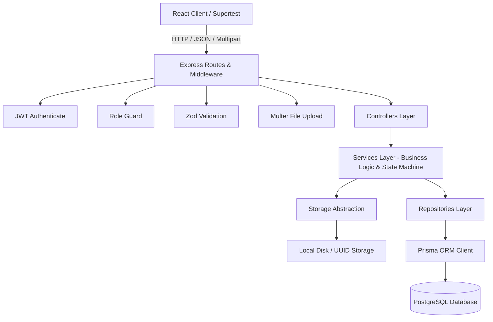
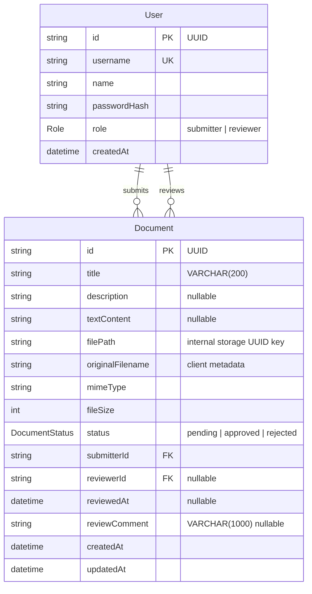
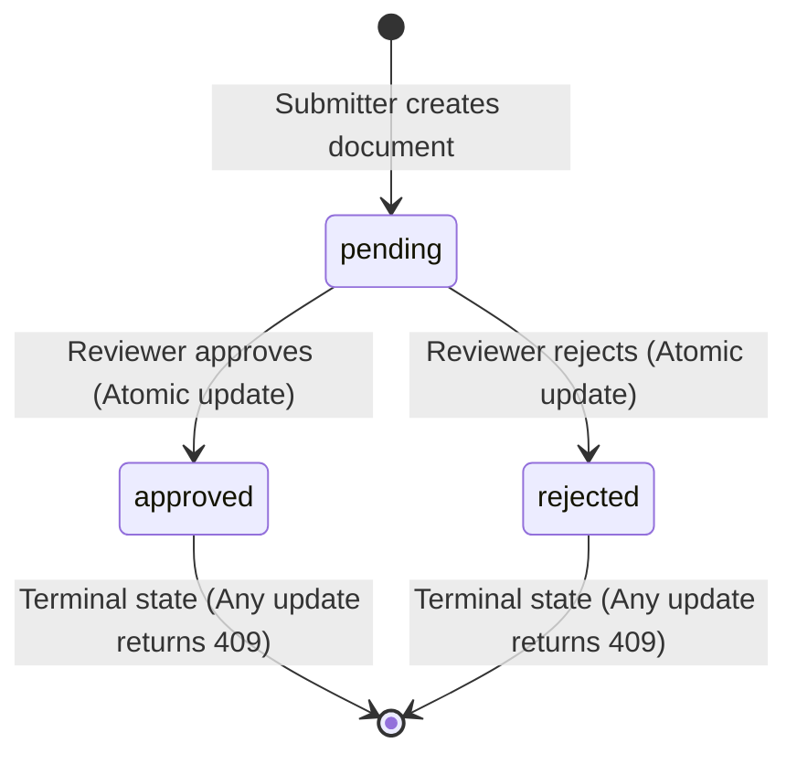

# Document Approval Workflow

A production-grade, extensible full-stack Document Approval Workflow application built for evaluative assessment. The system enables submitters to submit documents (text and/or file attachments) and track review decisions, while reviewers can inspect submissions, download attachments, and record immutable approve/reject decisions with atomic race-condition safety.

**Live URL:** TODO  
**Video walkthrough (Loom):** TODO

---

## 1. Features

### Submitter Role

- **Document Submission:** Submit proposals with a title (1–200 characters) and at least one of textual content or an attached file. Both are supported simultaneously.
- **Client & Server File Validation:** Supports `.pdf`, `.txt`, `.md`, `.doc`, `.docx`, `.png`, `.jpg`, and `.jpeg` attachments up to 5 MB with zero-byte detection.
- **Personal Dashboard & Isolation:** Submissions are strictly scoped to the authenticated submitter (`submitterId` extracted securely from JWT). Submitters cannot list or access other users' documents.
- **Status Tracking & Visibility:** View submission statuses (`pending`, `approved`, `rejected`) with color-coded status badges, reviewer feedback comments, and decision timestamps.
- **Pagination & Filters:** Filter submissions by status tabs (`All`, `Pending`, `Approved`, `Rejected`) with paginated navigation.
- **Authorized File Downloads:** Stream attached files with proper `Content-Disposition` headers and content streaming.

### Reviewer Role

- **Review Queue:** Unified dashboard listing all submissions across the organization, defaulting automatically to `pending` status.
- **Document Detail Inspection:** Inspect document metadata, submitter information, proposal text, and download attachments.
- **Status Decision Workflow:** Approve or reject pending documents with an optional comment (up to 1,000 characters).
- **Confirmation Step:** Interactive confirmation modal prevents accidental status changes.
- **Race Condition Protection:** Atomic state machine (`pending -> approved` | `rejected`) enforces that a document can only be decided once. If two reviewers decide simultaneously, exactly one succeeds and the other receives a graceful 409 conflict notification.

---

## 2. Tech Stack & Architectural Justifications

| Layer                  | Technology                           | Justification                                                                                                    |
| :--------------------- | :----------------------------------- | :--------------------------------------------------------------------------------------------------------------- |
| **Backend Runtime**    | Node.js (v20+ LTS)                   | Native ES modules (`"type": "module"`), high-performance asynchronous I/O, native `--watch` dev mode.            |
| **Backend Framework**  | Express.js                           | Mature, lightweight HTTP routing with minimal abstraction overhead.                                              |
| **ORM & Database**     | Prisma ORM + PostgreSQL              | Type-safe migrations, declarative schema, connection pooling, and ACID guarantees for atomic state transitions.  |
| **Validation**         | Zod                                  | Strictly validated schemas for environment variables, request bodies, query params, and route parameters.        |
| **Authentication**     | JWT (`jsonwebtoken`) + `bcryptjs`    | Stateless authentication with 10-round bcrypt password hashing and token expiry.                                 |
| **File Uploads**       | Multer                               | Streaming multipart parser with file size limits, MIME type filtering, and orphan cleanup.                       |
| **Security & Logging** | Helmet + CORS + Pino                 | Secure HTTP headers, restricted origin enforcement, structured JSON logging with automatic credential redaction. |
| **API Documentation**  | OpenAPI 3.0 + Swagger UI             | Complete machine-readable contract served interactively at `/api/docs`.                                          |
| **Frontend Framework** | React 18 + Vite                      | Fast HMR, minimal bundle footprint, standard component composition.                                              |
| **Routing**            | React Router v6                      | Declarative client-side routing with role-based route guards (`RoleRoute`, `ProtectedRoute`).                    |
| **Styling**            | Vanilla CSS (CSS Variables)          | Tailored design system tokens without heavy UI framework bloat or arbitrary utility classes.                     |
| **Testing**            | Vitest + Supertest + Testing Library | Blazing-fast testing pipeline covering unit, integration, and UI component layers.                               |

---

## 3. Architecture Overview

### Layered Architecture

The backend is structured into three clean, decoupled layers with strict unidirectional dependencies:

1. **Controllers (`src/modules/*/controller.js`)**: Thin HTTP entry points that parse requests and serialize responses. No business rules or database calls.
2. **Services (`src/modules/*/service.js`)**: Encapsulate all business rules, visibility policies, state transitions, and orphan cleanup. Fully testable in isolation without HTTP mocks.
3. **Repositories (`src/modules/*/repository.js`)**: Encapsulate all database access. The only layer authorized to import and invoke Prisma.



### Monorepo Structure

```text
th_assignment/
├── .gitignore
├── .prettierrc
├── .prettierignore
├── docker-compose.yml                   # PostgreSQL container with app and test databases
├── docker/
│   └── init-db.sql                      # Idempotent DB initialization script
├── package.json                         # Root orchestration scripts
├── README.md                            # Comprehensive technical documentation
├── render.yaml                          # Backend & database deployment specification
├── backend/
│   ├── .env.example                     # Environment template
│   ├── .env.test.example                # Test environment template
│   ├── eslint.config.js                 # Backend lint rules
│   ├── openapi.yaml                     # Complete OpenAPI 3.0 specification
│   ├── package.json
│   ├── vitest.config.js                 # Serial test runner configuration
│   ├── prisma/
│   │   ├── schema.prisma                # Database models and composite indexes
│   │   ├── migrations/                  # Version-controlled migrations
│   │   └── seed.js                      # Idempotent seed script
│   ├── src/
│   │   ├── app.js                       # Express app builder (imported by tests)
│   │   ├── server.js                    # HTTP listen with graceful shutdown
│   │   ├── config/env.js                # Zod fail-fast environment validator
│   │   ├── lib/
│   │   │   ├── errors.js                # Standard AppError hierarchy
│   │   │   ├── logger.js                # Redacted Pino logger
│   │   │   └── prisma.js                # Singleton PrismaClient
│   │   ├── middleware/
│   │   │   ├── authenticate.js          # JWT bearer token verification
│   │   │   ├── errorHandler.js          # Standard error envelope formatter
│   │   │   ├── notFound.js              # 404 handler
│   │   │   ├── requireRole.js           # Role authorization guard
│   │   │   ├── upload.js                # Multer upload & MIME filter
│   │   │   └── validate.js              # Zod request validation
│   │   ├── modules/
│   │   │   ├── auth/                    # Auth controller, service, routes, schema
│   │   │   └── documents/               # Documents controller, service, repository, routes, schema
│   │   └── storage/
│   │       ├── diskStorage.js           # Local disk implementation (UUID files)
│   │       └── storageInterface.js      # Storage interface for future S3 swap
│   └── tests/
│       ├── setup/                       # Global migration runner & table truncation hook
│       ├── unit/                        # Rules, state machine, visibility, file validator tests
│       └── integration/                 # Supertest API tests & concurrency race-condition tests
└── frontend/
    ├── .env.example
    ├── eslint.config.js
    ├── index.html
    ├── package.json
    ├── vercel.json                      # Vercel SPA client rewrite configuration
    ├── vite.config.js
    ├── vitest.config.js
    └── src/
        ├── main.jsx
        ├── App.jsx
        ├── context/AuthContext.jsx      # Auth state, token sync, auto-logout
        ├── hooks/                       # useAuth, useDocuments, useToast
        ├── services/
        │   ├── apiClient.js             # Centralized Fetch wrapper & error normalizer
        │   ├── authService.js
        │   └── documentService.js
        ├── components/
        │   ├── layout/                  # AppShell, ProtectedRoute, RoleRoute
        │   ├── ui/                      # Button, Badge, Spinner, Skeleton, Modal, Toast, ErrorBanner, FormField
        │   └── documents/               # SubmissionForm, DocumentTable, DocumentDetailModal, ReviewActions, StatusFilter
        ├── pages/                       # LoginPage, SubmitterDashboard, ReviewerDashboard, NotFoundPage
        ├── styles/                      # variables.css, base.css, layout.css, components.css
        └── tests/                       # RTL tests: Login, Submission, Reviewer, Badges, Guards
```

---

## 4. Setup & Running Instructions

### Prerequisites

- **Node.js**: v20.x or higher LTS
- **npm**: v10.x or higher
- **PostgreSQL**: Local PostgreSQL 16+ or Docker Compose

### Quick Start (Fewest Commands)

```bash
# 1. Install all dependencies across root, backend, and frontend
npm run setup

# 2. Start PostgreSQL via Docker Compose (or use your local PostgreSQL)
npm run db:up

# 3. Run database migrations and seed demo data
npm run db:migrate
npm run seed

# 4. Start both backend (port 4000) and frontend (port 5173) concurrently
npm run dev
```

Visit the application in your browser at `http://localhost:5173`.  
Explore interactive API documentation at `http://localhost:4000/api/docs`.

### Detailed Backend Setup

```bash
cd backend
cp .env.example .env
# Adjust DATABASE_URL in .env if not using standard postgres:postgres@localhost:5432
npm install
npm run db:migrate
npm run seed
npm run dev
```

### Detailed Frontend Setup

```bash
cd frontend
cp .env.example .env
npm install
npm run dev
```

### Demo Credentials

| Role          | Username | Password        | Purpose                                           |
| :------------ | :------- | :-------------- | :------------------------------------------------ |
| **Submitter** | `alice`  | `Passw0rd!demo` | Create proposals, view personal submissions       |
| **Submitter** | `bob`    | `Passw0rd!demo` | Second submitter to verify user data isolation    |
| **Reviewer**  | `riley`  | `Passw0rd!demo` | Review queue, approve or reject submissions       |
| **Reviewer**  | `rohan`  | `Passw0rd!demo` | Test race conditions between concurrent reviewers |

> **Tip:** The Login page includes convenient quick-fill buttons for each demo account for rapid evaluation.

### Troubleshooting

- **Database Connection Refused:** Verify that PostgreSQL is running on port 5432 (`docker compose ps` or local service status). Ensure the password in `backend/.env` matches your database instance.
- **Port Conflict on 4000 or 5173:** Configure `PORT` in `backend/.env` or `server.port` in `frontend/vite.config.js`.

---

## 5. Running Tests

Run the complete test suite across both backend and frontend with a single command from the root directory:

```bash
npm test
```

This executes:

1. **Backend Vitest Suite (48 tests):** Deploys Prisma migrations to the test database (`DATABASE_URL_TEST`), isolates database state with table truncation between test runs, and exercises unit logic and full API integration.
2. **Frontend Vitest Suite (20 tests):** Renders components inside JSDOM with React Testing Library, testing form validation, reviewer decision flows, 409 conflict banners, status badge styles, and route guard redirects.

```text
Backend:  8 test files passed (48 tests)
Frontend: 5 test files passed (20 tests)
Total:    13 test files passed (68 tests, 0 failures)
```

### Test Database Lifecycle

Backend tests execute against `document_workflow_test`. The `backend/tests/setup/globalSetup.js` hook automatically runs `prisma migrate deploy` before any test runs. The `backend/tests/setup/testDb.js` hook runs `TRUNCATE TABLE "documents", "users"` and re-seeds clean demo accounts before each test, guaranteeing test repeatability and total isolation.

---

## 6. API Design & OpenAPI Reference

Interactive Swagger documentation is available at `GET /api/docs`.

### Summary of Endpoints

| Method  | Path                        | Auth / Role           | Description                                               | Status Codes                             |
| :------ | :-------------------------- | :-------------------- | :-------------------------------------------------------- | :--------------------------------------- |
| `GET`   | `/api/health`               | Public                | System health check                                       | `200`                                    |
| `GET`   | `/api/docs`                 | Public                | Interactive Swagger UI documentation                      | `200`                                    |
| `POST`  | `/api/auth/login`           | Public (Rate Limited) | Authenticate user credentials & issue JWT                 | `200`, `400`, `401`, `429`               |
| `GET`   | `/api/auth/me`              | Authenticated         | Retrieve current user profile                             | `200`, `401`                             |
| `POST`  | `/api/documents`            | Submitter             | Submit new document (multipart/form-data)                 | `201`, `400`, `401`, `403`, `413`, `415` |
| `GET`   | `/api/documents`            | Authenticated         | List documents (Submitter: own; Reviewer: all)            | `200`, `400`, `401`                      |
| `GET`   | `/api/documents/:id`        | Authenticated         | Get document detail (isolation: 404 for other user's doc) | `200`, `401`, `404`                      |
| `GET`   | `/api/documents/:id/file`   | Authenticated         | Authorized document attachment download stream            | `200`, `401`, `404`                      |
| `PATCH` | `/api/documents/:id/status` | Reviewer              | Record approve or reject decision on pending document     | `200`, `400`, `401`, `403`, `404`, `409` |

### Standardized Error Envelope

All error responses across the entire API follow a uniform envelope:

```json
{
  "error": {
    "code": "validation_error",
    "message": "Request validation failed",
    "details": {
      "title": ["Title cannot be empty"]
    }
  }
}
```

### Design Rationale

- **Why `PATCH /api/documents/:id/status`?** Updating a status transition modifies only a subset of the document resource rather than replacing the entity (`PUT`).
- **409 Conflict vs 400 Bad Request:** A non-pending document cannot be transitioned. This is a state machine conflict with the current state of the resource, making `409 Conflict` the semantically correct HTTP status code per RFC 9110.
- **404 Not Found vs 403 Forbidden for Other Users' Documents:** When a submitter requests another user's document, returning 403 would leak information confirming that the document exists. Returning `404 Not Found` ensures complete privacy and zero data leakage.
- **Layered Service/Repository Pattern:** Business logic (state transitions, authorization checks, orphan file cleanup) is isolated in pure services that can be unit tested without starting Express or mocking HTTP streams.

---

## 7. Major Decisions & System Design

### Data Model (Mermaid ER Diagram)



### Status State Machine (Mermaid State Diagram)



### Full List of Resolved Decisions

1. **Identity & Authentication:** JWT token with bcrypt-hashed passwords. No public registration route. Submissions derive `submitterId` strictly from the authenticated token, never request inputs.
2. **Strict Single Roles:** Each user is assigned either `submitter` or `reviewer`. Role boundaries are verified on the server via `requireRole` middleware.
3. **Content Requirement:** Every submission requires a non-empty `title` and at least one of `file` or `textContent`. Both are permitted.
4. **Visibility & Privacy Isolation:** Reviewers can list and view all documents. Submitters can only access their own. Requesting another user's document yields 404 to avoid existence leakage.
5. **Immutable Terminal States:** `pending -> approved` and `pending -> rejected` are final transitions. Any duplicate or cross-decision returns 409.
6. **Optional Reviewer Feedback:** Review comments are capped at 1,000 characters and recorded alongside the reviewer's ID and timestamp.
7. **File Security & Constraints:** Whitelist of `.pdf, .txt, .md, .doc, .docx, .png, .jpg, .jpeg` with dual extension and MIME validation. Empty files rejected. Max 5 MB limit. Internal filenames use randomized UUIDs; client names remain metadata.
8. **Scope Boundaries:** Document editing, deletion, withdrawal, resubmission, and email notifications are intentionally out of scope for iteration 1.

### Trade-offs Made for Evaluation Scope

- **Local Disk Storage:** Utilized a swappable `StorageInterface` abstraction with local disk storage for simplicity in local evaluation, avoiding external AWS S3 credential requirements.
- **LocalStorage JWT:** Stored token in `localStorage` with central auto-logout on 401 instead of `httpOnly` cookie + CSRF token setup to allow straightforward cross-origin local testing.
- **No Refresh Token Flow:** Kept token lifecycle to an 8-hour access token rather than implementing token rotation tables.

---

## 8. Edge Cases Handled Checklist

- [x] **Race Conditions:** Two reviewers concurrently reviewing the same pending document — handled atomically via `updateMany({ where: { id, status: 'pending' } })`. Exactly one succeeds; the loser receives 409.
- [x] **Orphan File Prevention:** If file upload succeeds but subsequent database validation fails (e.g. empty title or missing text/file requirement), the uploaded file is purged from disk.
- [x] **Information Leakage:** Submitter querying another user's document receives 404 rather than 403.
- [x] **Path Traversal Protection:** Stored files are named via `crypto.randomUUID()`. Original filenames are never used in filesystem paths.
- [x] **Empty File Uploads:** Uploading a 0-byte file is rejected and unlinked from disk immediately.
- [x] **File Size Enforcement:** Files > 5 MB trigger Multer `LIMIT_FILE_SIZE` mapped to standard HTTP 413.
- [x] **Disallowed File Types:** Uploading `.exe` or disallowed MIME types returns HTTP 415.
- [x] **Whitespace-Only Titles:** Titles composed entirely of whitespace are trimmed and rejected as empty.
- [x] **Invalid UUIDs in Paths:** Non-UUID identifiers passed in routes return 404 rather than 500 database crashes.
- [x] **Malformed JSON:** Malformed JSON in request bodies is caught and formatted into standard 400 envelopes.
- [x] **User Enumeration Defense:** Login failures return constant-time "Invalid credentials" error regardless of whether the username exists.
- [x] **Brute-Force Protection:** Auth login endpoint is rate-limited via `express-rate-limit`.
- [x] **Credential Redaction:** Sensitive headers (`Authorization`) and passwords are automatically redacted in server logs.

---

## 9. AI Tools Used

This project was built with assistance from **Google Antigravity**:

- **Scaffolding:** Architecting monorepo layout, Docker Compose configuration, and Prisma schema.
- **Modules & Business Rules:** Implementing layered controller-service-repository patterns, file storage abstraction, and atomic state transitions.
- **Test Generation:** Authoring comprehensive unit and integration test suites covering concurrent reviewer race conditions and orphan cleanup.
- **Technical Documentation:** Drafting structured OpenAPI specifications and markdown documentation.

_Candidate Notes:_ All architecture choices, atomic race-condition safety, and test coverage were thoroughly verified through local automated testing and end-to-end execution.

---

## 10. Production Enhancements (What I Would Add for Production)

1. **Cloud Object Storage (S3 / GCS):** Swap `diskStorage.js` with an S3 implementation generating time-limited pre-signed URLs for downloads.
2. **Virus & Malware Scanning:** Integrate ClamAV or AWS GuardDuty to scan uploaded attachments before making them available for download.
3. **Enhanced Authentication:** Implement `httpOnly` secure cookies with short-lived access tokens, refresh token rotation, and SSO (OIDC/SAML).
4. **Audit Log & History Table:** Maintain an append-only `DocumentAuditLog` tracking all lifecycle events, previous states, and actor metadata.
5. **Multi-Stage Approval Workflows:** Support multi-step approval pipelines (e.g. Finance approval -> Legal approval) with configurable reviewer groups.
6. **Asynchronous Background Processing:** Offload document thumbnail generation, OCR, and email notifications to Redis-backed BullMQ queues.
7. **End-to-End Tests:** Add Playwright browser tests covering full submitter-to-reviewer interactions.
8. **Observability & APM:** Export OpenTelemetry metrics and traces to Prometheus / Datadog.

---

## 11. Deployment Guide

### Backend on Render / Railway

1. Create a Managed PostgreSQL instance.
2. Deploy the `backend/` folder as a Web Service.
3. Set the release command to `npm run db:migrate && npm run seed`.
4. Configure environment variables:
   - `PORT`: `4000` (or platform default)
   - `NODE_ENV`: `production`
   - `DATABASE_URL`: Your managed database connection string
   - `JWT_SECRET`: Secure 32+ character key
   - `CLIENT_ORIGIN`: Your frontend URL
   - `UPLOAD_DIR`: `/var/data/uploads` (or connect persistent disk / S3)

### Frontend on Vercel / Netlify

1. Connect repository with Root Directory set to `frontend`.
2. Build Command: `npm run build`. Output Directory: `dist`.
3. Set environment variable:
   - `VITE_API_URL`: Your deployed backend API URL (e.g., `https://api.yourdomain.com/api`).
4. The included `frontend/vercel.json` ensures client-side routes redirect properly to `index.html`.

---

## 12. Known Limitations

- **Local Storage of Uploaded Files:** Uploaded files reside on the local server disk. In a multi-replica autoscaled environment, a shared object store (such as Amazon S3) is required.
- **Single Decision Maker:** A document is reviewed by exactly one reviewer. Complex workflows with multiple concurrent approval tiers are left for subsequent iterations.
- **No Document Editing:** Once submitted, a document cannot be modified or replaced; it must be approved or rejected as submitted.
